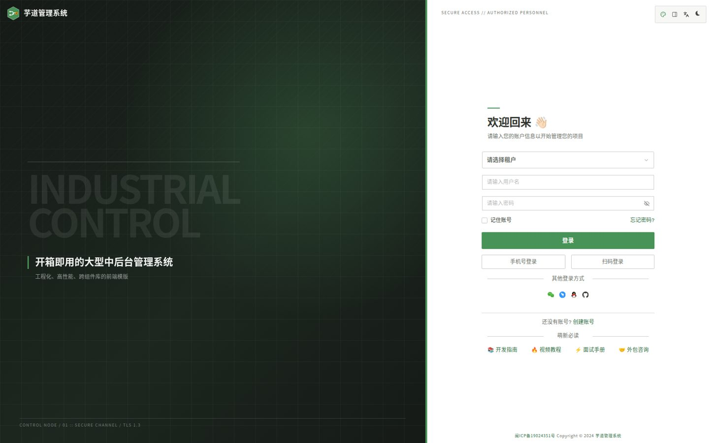

# Industrial Console Theme

芋道前端（`apps/web-antd`）的工业控制台视觉层。参考 FortiGate / FortiOS 控制台：

- 深色设备栏 + `#489257` 深绿色指挥栏
- 白色高密度工作区，1px 细边框、2px 方角
- 状态色只用于语义提示：绿色正常、橙色警告、蓝色信息、红色危险
- 表格、表单、弹窗、抽屉、登录页共用同一套几何与层级规则

## 文件职责

| 文件 | 负责范围 |
| --- | --- |
| `theme.css` | 全局 CSS 变量、字体、滚动条、暗色变量 |
| `shell.css` | 顶栏、侧栏、菜单、页签、面包屑、内容画布 |
| `components.css` | Ant Design Vue 组件皮肤 |
| `data.css` | VXE Grid、页面容器、仪表盘卡片 |
| `login.css` | 登录 / 认证页 |

入口在 `apps/web-antd/src/bootstrap.ts`，必须晚于 `@vben/styles/antd` 引入。主题偏好与品牌资源在 `apps/web-antd/src/preferences.ts`。

## 品牌替换

- Logo：`apps/web-antd/public/industrial-logo.svg`
- Favicon：`apps/web-antd/public/favicon.svg`
- 默认头像：`apps/web-antd/public/avatar-placeholder.svg`
- 应用名称：`apps/web-antd/.env` 中的 `VITE_APP_TITLE`

## 新增页面时的约定

- 页面外层使用 `Page`，列表使用 `useVbenVxeGrid`，会自动继承同一套面板和表格样式。
- 普通卡片优先使用 `Card` / `[data-slot="card"]`，不要额外加圆角和阴影。
- 自定义状态色请使用 `var(--ind-green)`、`var(--ind-orange)`、`var(--ind-blue)`、`var(--ind-red)`。
- 不要在页面内再写 `border-radius > 2px`、渐变按钮或玻璃拟态；这会破坏控制台的整体刚性。
- 修改颜色时优先改 `theme.css` 的 `--ind-*` 变量；同时检查 `.dark` 下的同名变量。

> 旧的浏览器缓存可能仍保存着默认主题（深色、蓝色、圆角）。首次切换主题后，如显示不一致，可在浏览器控制台清空本站 `localStorage` 后刷新。
